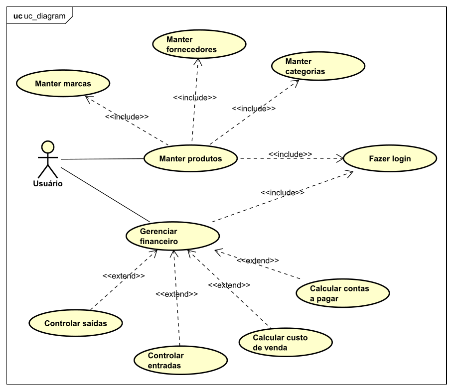
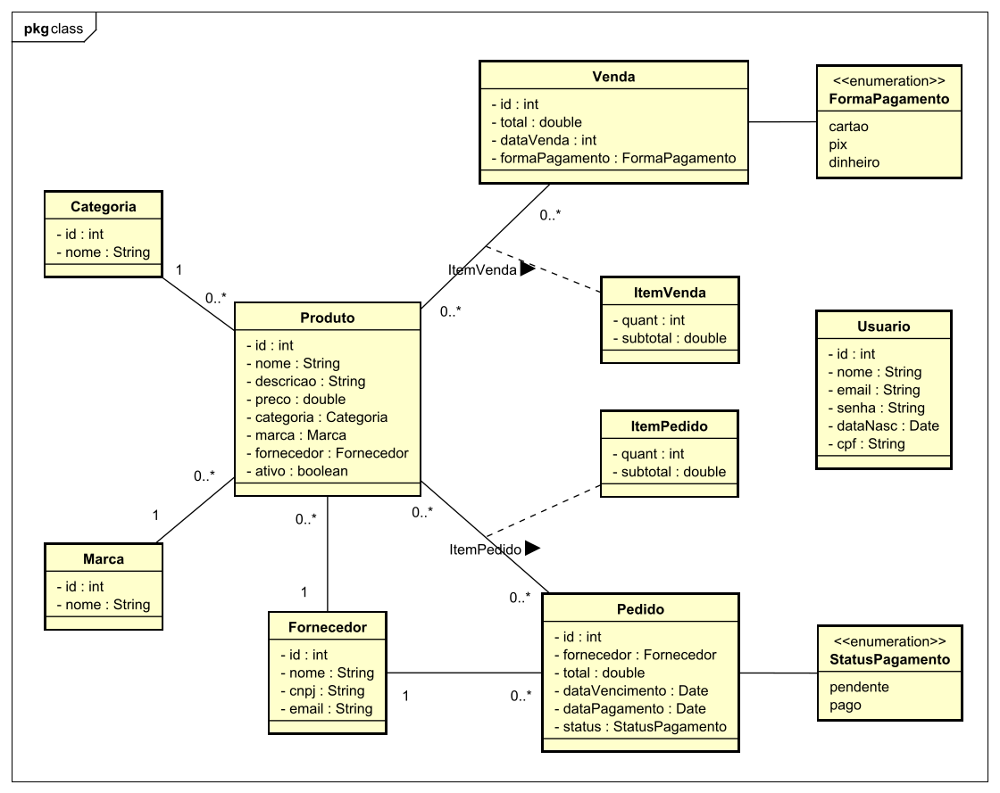

<p align="left">
  &nbsp;
  &nbsp;
  &nbsp;
  &nbsp;
  &nbsp;
</p>

# SmartInventory - Sistema de Controle de Estoque e Fluxo de Caixa

O **SmartInventory** é um sistema de gerenciamento inteligente de estoque e controle financeiro. O sistema permite o cadastro de produtos vinculados às suas respectivas marcas, categorias e fornecedores. Além disso, realiza o balanço automático de lucros monitorando as entradas através de **Vendas** e as saídas por meio de **Pedidos de Fornecimento**.

## 🗺️ Modelagem do Sistema

---

### Diagrama de Casos de Uso
O diagrama de casos de uso ilustra como o usuário interage com as fronteiras do sistema, destacando os fluxos de cadastros e o controle do fluxo de caixa.



### Diagrama de Classes
O diagrama de classes representa a estrutura de dados e as regras de negócio. Ele utiliza as tabelas associativas `ItemVenda` e `ItemPedido` para garantir a integridade do estoque e dos históricos de preços de custo e venda.



---

## 🛠️ Tecnologias Utilizadas

---

### Back-End


* **Java:** Linguagem de programação robusta e orientada a objetos utilizada no desenvolvimento da lógica principal da aplicação.
* **Spring Boot:** Framework Java utilizado para acelerar o desenvolvimento da API RESTful, gerenciando injeção de dependências e segurança.
* **Hibernate/JPA:** Framework ORM utilizado para o mapeamento objeto-relacional, abstração de queries do banco de dados e validação de entidades.
* **Spring Security:** Módulo do Spring responsável pelo controle de acesso, gestão de permissões e autenticação segura dos usuários.
* **Swagger (OpenAPI):** Ferramenta utilizada para gerar a documentação interativa da API REST, facilitando testes e integração.
* **PostgreSQL:** Sistema de gerenciamento de banco de dados relacional (SGBD) utilizado para o armazenamento seguro e estruturado dos dados.
* **Docker:** Plataforma de containerização utilizada para padronizar e isolar os ambientes de desenvolvimento e implantação da aplicação.

### Front-End


* **React:** Biblioteca JavaScript focada na construção de interfaces de usuário reativas e baseadas em componentes reutilizáveis.
* **Vite:** Ferramenta de build de última geração utilizada para proporcionar um ambiente de desenvolvimento ágil e otimização do pacote final.
* **Bootstrap:** Framework CSS utilizado para agilizar a estilização e garantir um design responsivo e acessível em diferentes telas.

## 🚀 Como Executar o Projeto

---

### 📋 Pré-requisitos

* **Git** instalado na sua máquina
* **Docker Desktop** (Windows, macOS ou Linux) rodando

### 🛠️ Passo a Passo

1. **Clonar o repositório:**
```bash
git clone https://github.com/ferreiraluizga/smart-inventory.git
cd smart-inventory
```

2. **Subir os containers (Back-end, Front-end e Banco):**
```bash
docker-compose up --build
```

3. **Acesse a aplicação**
* 💻 Front-End: [http://localhost:5173](http://localhost:5173)
* 📑 Swagger UI (Documentação do Back-End): [http://localhost:8080/swagger-ui/index.html](http://localhost:8080/swagger-ui/index.html)

## 📁 Estrutura do Projeto

---

### 🖥️ Back-End (Spring Boot)

```text
backend/
├── src/main/java/
│   └── com.ferreiraluizga.smartinventory/
│       ├── config/          # Configurações (Security, CORS, etc)
│       ├── controller/      # Controllers REST
│       ├── dto/             # Objetos de transferência (records)
│       ├── entity/          # Entidades JPA
│       ├── exception/       # Tratamento de erros globais da aplicação
│       ├── mapper/          # Conversões Entity <-> DTO
│       ├── repository/      # Acesso ao banco de dados
│       ├── security/        # Sistema de autenticação da API          
│       └── service/         # Regras de negócio
│
├── src/main/resources/
│   ├── application.yml      # Configuração da aplicação
│   └── data.sql             # Seeder do banco de dados
│
└── Dockerfile
````

### 🌐 Front-End (React)

```text
frontend/
├── src/
│   ├── api/                # Conexão com o back-end
│   ├── assets/             # Estilos do front-end
│   ├── components/         # Componentes reutilizáveis
│   ├── pages/              # Páginas da aplicação
│   ├── routes/             # Rotas da aplicação
│   ├── services/           # Comunicação com API (Axios)
│   └── App.jsx             # Implementação do React Router
│
├── index.html              # Configuração do SPA (Single Page Application)
└── vite.config.js          # Configuração do Vite
```
